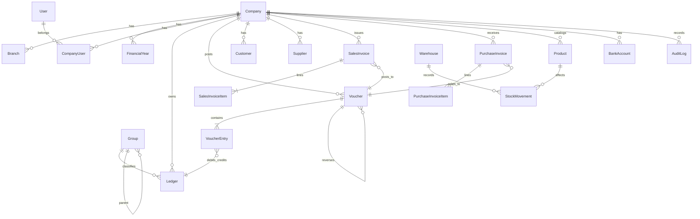

# LedgerFlow ERP — Phase 1: Architecture & Design

**Date:** 2026-11-08  
**Status:** Phase 1 complete (design baseline) — implementation begins in Phase 2+

## 1. Requirements analysis (summary)

LedgerFlow is a production-oriented, multi-company accounting and business management platform inspired by Tally Prime/BUSY. Core constraints from the brief:

- **Accounting correctness first**: strict double-entry (`TOTAL DEBIT = TOTAL CREDIT` per posted voucher), immutable posted vouchers, reversal/adjustment corrections only, atomic financial operations, decimal/numeric money (never float), audited changes.
- **Tenant isolation**: users may belong to multiple companies; no cross-company access without explicit authorization; enforce at API and query layers.
- **India GST focus**: CGST/SGST/IGST/UTGST, HSN/SAC, intra/inter-state, configurable rules/effective dates; compliance integrations (e-invoice/e-way/GSTR filing) are *readiness/interfaces* until authorized APIs are implemented.
- **Security**: defense in depth (Argon2id, sessions in HTTP-only secure cookies, MFA, RBAC/permissions, validation, rate limits, audit logs, encrypted transport/at-rest posture).
- **Persistence**: PostgreSQL (Prisma), Redis (cache/jobs/sessions support), object storage (S3-compatible) for attachments/backups.
- **UX**: fast accounting workflows, responsive, light/dark, no fake buttons/hardcoded production figures.

## 2. Existing repository assessment

The repository (`C:\Users\Luv\ledgerflow`) contained a **Next.js 15 frontend slice** before this phase:

- `src/app/*`, `src/lib/finance.ts` (demo INR formatting + simple in-memory aggregation), `src/lib/dashboard-data.ts` (sample data), `src/lib/finance.test.ts` (Vitest).
- **Preservation decision**: keep the existing web app runnable at the repository root during early phases; add `server/` (Express API), `docs/`, `docker/`, and workspace-aware structure incrementally. Existing UI will be migrated to consume real APIs once auth/tenant context and backend modules exist.

**Working features to preserve:** dashboard render, theme/toggle behavior, search/filter demo, invoice dialog (in-memory), `pnpm test` for `finance.test.ts`, `pnpm dev/build/lint` for the web app.

## 3. System architecture

### 3.1 High-level components

| Layer | Technology | Responsibility |
|---|---|---|
| Web app | Next.js (App Router), React, TS, Tailwind, shadcn/ui, TanStack Query, Zustand, RHF+Zod, Recharts | UI, forms, client state, server-state caching; calls backend REST APIs |
| API | Node.js, Express, TS | Auth, RBAC, tenant scoping, validation, accounting engine, business modules, reports, exports |
| Database | PostgreSQL + Prisma | System of record; financial integrity via constraints + transactions |
| Cache/jobs | Redis | Session/cache support, rate limiting, background jobs (imports, report snapshots, notifications) — introduced incrementally |
| Object storage | S3-compatible | Attachments, exports, backups |
| Edge/proxy | Nginx | TLS termination, routing, headers, static/proxy rules |
| CI/CD | GitHub Actions | Lint, typecheck, tests, migrations checks, security scans, builds |

### 3.2 Logical boundaries (modules)

1. **Identity & Access**: users, sessions, MFA, password reset, roles/permissions, login history.
2. **Tenancy**: companies, branches, financial years, company users/permissions, settings.
3. **Accounting Core**: chart of accounts/groups/ledgers, vouchers + entries (double-entry), journal, cost centres, opening/closing, numbering, reversals.
4. **Sales/Purchase**: documents, line items, returns/notes, receivables/payables ledgers.
5. **Inventory**: products, warehouses, movements, valuation (FIFO/WAC), batches/serials, adjustments/transfers.
6. **GST**: registrations, rates/HSN/SAC masters, tax computation per line/transaction, registers, return data preparation (readiness).
7. **Banking**: accounts, transactions, reconciliation, cheque lifecycle, statement imports.
8. **Reporting**: read models/queries over posted accounting + subledgers; drill-down; PDF/Excel export.
9. **Admin/Audit**: audit log viewer, backups metadata, system config; immutable audit records.
10. **AI (optional, later)**: isolated services/endpoints; **never auto-post** financial transactions; insights labeled as non-authoritative.

### 3.3 Request flow (financial write)

1. Client submits validated payload (RHF+Zod) → API.
2. API authenticates session, resolves `companyId`/branch/FY context, checks permission.
3. Service validates business rules (dates in open FY, voucher numbering scope, stock/GST rules).
4. **Single DB transaction**: create voucher/document + balanced debit/credit lines + subledger rows (stock, GST, party) + audit event. Use `DECIMAL`/`NUMERIC` and deterministic rounding rules (documented per module).
5. Commit; invalidate relevant caches; return canonical result.

### 3.4 Deployment topology (target)

- `web` (Next.js) + `api` (Express) containers behind Nginx.
- `postgres` and `redis` services (managed in production).
- Migrations run as a controlled release step (`prisma migrate deploy`).
- Secrets via environment/secret manager; never committed.

## 4. Database design principles

- **UUID** primary keys (`@db.Uuid`); `created_at`, `updated_at` on mutable records.
- **Soft delete** only for eligible master data (e.g., inactive products/parties) — never for posted `vouchers`, `journal_entries`, `audit_logs`, finalized financial documents.
- **Money**: `Decimal`/`NUMERIC(19,4)` (or agreed precision) for amounts, rates, quantities where fractional; tax calculations use explicit rounding strategy stored/tested.
- **Immutability**: posted vouchers/entries have `status=POSTED` and are write-protected; corrections create reversal/adjustment vouchers linked to originals.
- **Uniqueness**: voucher number unique per `(company_id, branch_id?, financial_year_id, voucher_type)` as configured.
- **Indexes**: tenant keys (`company_id`), dates, voucher/document numbers, foreign keys, status, search fields.
- **RLS consideration**: application-level tenant filtering is mandatory; PostgreSQL RLS can be added later as defense-in-depth (Phase 7+ hardening).

## 5. Entity relationship overview (core)



*Full table inventory is tracked in `docs/database/schema-design.md` and implemented incrementally in Prisma migrations.*

## 6. API contract strategy

- **Style**: REST, JSON, versioned base path (`/api/v1`).
- **Auth**: session cookie (HTTP-only, Secure, SameSite policy), CSRF protection for cookie-authenticated unsafe methods; MFA challenge flow.
- **Tenant context**: `companyId` resolved from session + explicit selection header/route context as designed; all data queries scoped by `companyId`.
- **Validation**: Zod schemas at API boundary; consistent error envelope (`code`, `message`, `details`, `traceId`).
- **Idempotency**: required for payment/import/webhook-like operations (Phase 4+).
- **Pagination/filtering**: cursor or offset pagination for lists; date/FY/branch filters on reports.
- **OpenAPI**: generated/maintained via Swagger tooling (Phase 2 foundation).

See `docs/api/contracts.md` for module endpoint map.

## 7. Folder structure (target)

```text
ledgerflow/
  apps/web/                 # (target) Next.js app — currently root acts as web app
  server/                   # Express API (Phase 2+)
    src/
      config/               # env, db, redis, logger
      middleware/           # auth, tenant, rbac, validation, errors, security
      modules/
        auth/
        tenancy/
        accounting/
        sales/
        purchases/
        inventory/
        gst/
        banking/
        reports/
        admin/
      jobs/
      lib/
    prisma/
      schema.prisma
      migrations/
    tests/
  packages/shared/          # (later) shared types/Zod contracts
  docs/
  docker/
  docker-compose.yml
  .env.example
```

**Current transitional state:** existing Next.js files remain at root to preserve functionality; `server/` is added alongside. Migration to `apps/web` will be done as a dedicated, tested refactor.

## 8. Security architecture

- **Identity**: Argon2id password hashes; MFA (TOTP-ready design); session revocation; login history and anomaly signals.
- **Access control**: RBAC + fine-grained permissions; company/branch/FY scoping; sensitive actions (period close, posting overrides where allowed) require elevated permission/audit.
- **Transport/storage**: HTTPS in deployment; DB encryption-at-rest per infrastructure; encrypted backups; secrets not logged.
- **AppSec**: input validation, Prisma parameterization, output encoding, CSP/Helmet, rate limiting, strict CORS, safe file upload validation (type/size/scanning hook).
- **Audit**: append-only audit records for auth, master data, and all financial posting/cancellation/reversal actions; non-editable by normal roles.

Details in `docs/security/architecture.md`.

## 9. Architectural risks & mitigations

| Risk | Impact | Mitigation |
|---|---|---|
| Accounting bugs (rounding/balancing) | Financial incorrectness | Decimal math, invariant checks in transaction, property/unit tests, reconciliation tests |
| Cross-tenant data leak | Severe compliance/security | Mandatory `companyId` scoping, middleware, integration tests for isolation |
| Voucher mutability/regression | Audit/legal issues | DB + service guards, immutable posted state, reversal-only corrections |
| GST rule complexity/changes | Incorrect tax | Configurable rules with effective dates, versioned logic, test vectors; no false filing claims |
| Large report queries | Performance | Indexes, pagination, pre-aggregation/jobs later, read replicas (future) |
| Scope size | Delivery risk | Strict phased delivery, runnable increments, tested core engine before breadth |

## 10. Phase 1 exit criteria

- [x] Requirements analyzed and constraints captured.
- [x] Architecture and module boundaries defined.
- [x] Core ERD and schema principles documented; Prisma draft direction established.
- [x] API contract map defined.
- [x] Folder structure and migration plan defined.
- [x] Security architecture and risks documented.
- [ ] **Next:** Phase 2 foundation (backend scaffold, Postgres/Redis Docker, Prisma connection, auth skeleton) while keeping web app runnable.
