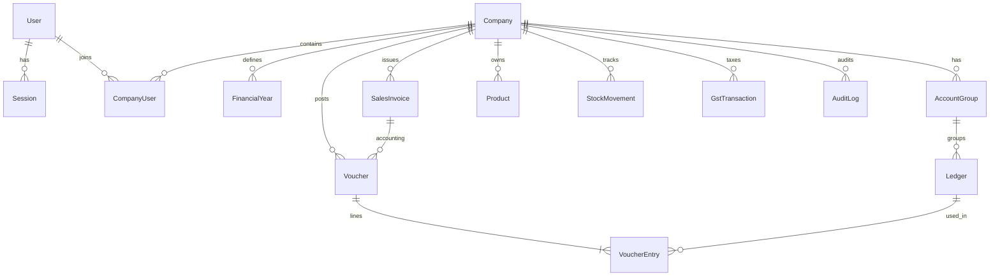

# LedgerFlow — Database Schema Design

PostgreSQL + Prisma. All financial amounts use `Decimal` (never float). UUID PKs. Timestamps on mutable tables. Tenant isolation via `company_id` (and related scope fields) on all company-owned data.

## Conventions

- `id` UUID `@default(uuid())`
- `company_id` required for tenant-owned records (nullable only for true global records like platform `User` before company membership, if modeled that way)
- `created_at`, `updated_at` `DateTime`
- `deleted_at` **only** for soft-deletable masters (not posted accounting/audit)
- Enums for status/type fields (voucher type, posting status, GST type, etc.)
- FK constraints + indexes on `(company_id, ...)`, dates, document numbers

## Entity groups (required coverage)

### Identity & access
`User`, `Role`, `Permission`, `UserRole`, `Session`, `LoginHistory`, `MfaDevice`, `PasswordResetToken`.  
- Passwords: Argon2id hash stored on `User` (or credential table). Sessions: hashed token/server-side record; cookie holds opaque session id.

### Tenancy
`Company`, `CompanySetting`, `Branch`, `FinancialYear`, `CompanyUser`, `CompanyPermission`.  
- `FinancialYear`: `startDate`, `endDate`, `isClosed`, `closedAt`; prevent posting outside open FY per rules.

### Accounting core
`AccountGroup` (tree), `Ledger` (belongs to group; opening balance side/amount), `ChartOfAccounts` view/config as needed, `Voucher`, `VoucherEntry` (ledger, debit, credit, narration/ref), `JournalEntry`/`JournalEntryLine` (if separated from voucher model — implementation may unify on Voucher+Entry with `type=JOURNAL`), `CostCentre`, `Budget`, `OpeningBalance`.  
- **Invariant**: for each posted `Voucher`, `SUM(VoucherEntry.debit) == SUM(VoucherEntry.credit)`.
- **Numbering**: unique `(companyId, financialYearId, voucherType, voucherNo)` (branch-scoped if configured).

### Sales
`Customer`, `Quotation`, `SalesOrder`, `SalesInvoice`, `SalesInvoiceItem`, `SalesReturn`, `CreditNote`, `DeliveryChallan`. Invoices post to vouchers (sales, GST output, party receivable).

### Purchase
`Supplier`, `PurchaseOrder`, `PurchaseInvoice`, `PurchaseInvoiceItem`, `PurchaseReturn`, `DebitNote`.

### Inventory
`Product`, `ProductCategory`, `Unit`, `Warehouse`, `StockMovement` (immutable ledger of qty changes), `StockAdjustment`, `StockTransfer`, `Batch`, `SerialNumber`, `PriceList`. Valuation computed from movements (FIFO/WAC) per company settings.

### GST
`GstRegistration`, `GstRate`, `HsnMaster`, `SacMaster`, `GstTransaction` (tax breakup per document/line), `GstReturn` (prepared data/metadata), `EInvoiceRecord`, `EWayBillRecord` (readiness/status tracking).

### Banking
`BankAccount`, `BankTransaction`, `BankReconciliation`, `Cheque`, `PaymentMethod`.

### Other
`Expense`, `Employee`, `Payroll` (scoped module), `FixedAsset`, `Loan`, `Notification`, `AuditLog` (append-only), `Attachment`, `BackupRecord`.

## Critical constraints & indexes (examples)

- `@@unique([companyId, financialYearId, voucherType, voucherNo])` on `Voucher`
- `@@index([companyId, date])` on `Voucher`, invoices, movements
- `@@index([companyId, ledgerId, date])` on `VoucherEntry` / posting views
- FK: `VoucherEntry.voucherId -> Voucher.id`, `VoucherEntry.ledgerId -> Ledger.id`
- Check/business logic (service + DB where practical): non-negative stock when disallowed; balanced voucher on post.

## Migration strategy

- Phase 2: create core identity + tenancy + accounting primitives (Company, User, Session, FinancialYear, AccountGroup, Ledger, Voucher, VoucherEntry, AuditLog).
- Subsequent phases: extend schema module-by-module with migrations; never rewrite posted-data history destructively.

## ERD (extended sketch)

